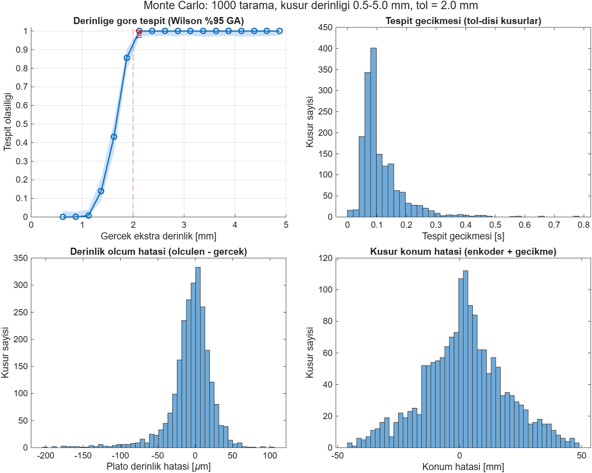
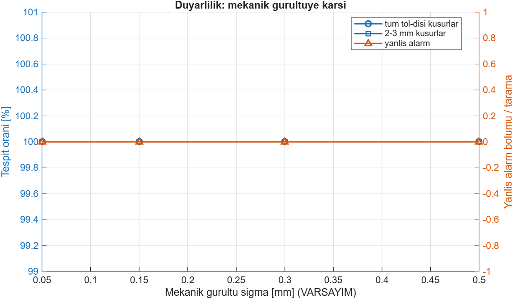

# V-Ağzı Kalite Kontrol Robotu (V-Bevel Inspection Robot)

[](https://www.mathworks.com/products/matlab.html)
[](https://www.mathworks.com/products/simulink.html)
[](#monte-carlo-do%C4%9Frulama-ve-duyarl%C4%B1l%C4%B1k-analizi)
[](#monte-carlo-do%C4%9Frulama-ve-duyarl%C4%B1l%C4%B1k-analizi)

Bu depo, kalın çelik plakalardaki (S335, 80 mm kalınlık) 13 metrelik kaynak ağzı boyunca otonom ilerleyerek derinlik ve profil kontrolü yapan **V-Ağzı Kalite Kontrol Robotu**'nun Simulink dinamik simülasyonunu ve stokastik Monte Carlo doğrulama ortamını içerir.

---

## 📌 Proje Özeti ve Çalışma Prensibi

Robot, kaynak öncesi açılan V-ağzı üzerinde $v = 20\text{ mm/s}$ sabit hızla ilerler ($13\text{ metre} = 650\text{ saniye}$). Robot gövdesinde yer alan LVDT temaslı prob ve tekerlekli enkoder ile kaynak ağzı derinlik profili milimetrik ve mikrometrik hassasiyette taranır.

* **Nominal Geometri:** Plaka referans kalınlığı $Z_1 = 80\text{ mm}$, sensör montaj tabanı $50\text{ mm}$, nominal V-ağzı derinliği $30\text{ mm}$.
* **Tolerans Eşiği:** $\pm 2.0\text{ mm}$ kaynak ağzı sapması sınır kabul edilir; eşik aşıldığında sistem anında hata alarmı üretir.
* **Filtreleme:** Atölye titreşimi ve yüzey pürüzlülüğü, $G(s) = \frac{1}{0.1s + 1}$ transfer fonksiyonuna sahip 1. derece alçak geçiren filtre ile süzülür.

```
[ Solartron LVDT Prob ] ---> [ Gürültü / Titreşim ] ---> [ Alçak Geçiren Filtre (0.1s) ]
                                                                     |
[ Enkoder (SICK DBV50) ] --------------------------------> [ Diferansiyel Derinlik Hesabı ]
                                                                     |
                                                          [ Tolerans Karşılaştırıcı (|e| > 2mm) ]
                                                                     |
                                                              [ ALARM / LOG ]
```

---

## 🛠️ Donanım ve Sensör Özellikleri

Modelde kullanılan sensör parametreleri üretici katalog ve veri sayfalarından (datasheet) türetilmiştir:

| Bileşen | Model / Tip | Temel Parametreler | Kaynak |
|---|---|---|---|
| **Temaslı Derinlik Probu** | Solartron Metrology AX/5/S | $\pm 5\text{ mm}$ aralık, $\%0.5$ doğrusallık, $0.07\text{ }\mu\text{m}$ tekrarlanabilirlik | Datasheet sf. 15 |
| **Sinyal Şartlandırıcı** | Solartron OD5 MK II | $500\text{ Hz}$ bant genişliği, $<1\text{ mV rms}$ gürültü ($\approx 3.2\text{ }\mu\text{m}$ elektriksel) | Manual sf. 24 |
| **Konum Enkoderi** | SICK DBV50E-22ELA1000 | Tekerlekli enkoder, $0.2\text{ mm/darbe}$ çözünürlük ($1000\text{ P/R}$), $\pm 4\text{ mm/m}$ hata sınırı | Datasheet sf. 2-3 |
| **İlerleme Mekanizması** | Otonom Tarama Arabası | $20\text{ mm/s}$ sabit hız, 13 metre toplam hat boyu | Tasarım Şartnamesi |

---

## 🚀 Hızlı Başlangıç (Nasıl Çalıştırılır?)

Sistem, mühendislik iş akışına uygun şekilde **tek tıkla çalışacak biçimde** tasarlanmıştır:

1. **MATLAB**'ı açın ve proje kök dizinine geçin.
2. [`main.m`](main.m) dosyasını açın.
3. MATLAB menüsünden yeşil **▶ Run** butonuna basın (veya klavyeden **`F5`** tuşuna basın).

Tüm simülasyon ve Monte Carlo analizi 4-5 saniye içerisinde tamamlanır; ekrana 3 adet grafik penceresi ve detaylı istatistiksel rapor açılır.

---

## 📊 Simülasyon Çıktıları

### 1. Simulink Dinamik Koşusu (`V_Kaynak_QC_Robot.slx`)
Model, 650 saniyelik tarama boyunca 100–120 s ve 350–380 s aralıklarında $3.5\text{ mm}$ lokal fazla dalma kusurlarını simüle eder:
* **Kusur 1 (100–120 s):** $3.508\text{ mm}$ ölçülen sapma $\rightarrow$ **YAKALANDI [ALARM]**
* **Kusur 2 (350–380 s):** $3.499\text{ mm}$ ölçülen sapma $\rightarrow$ **YAKALANDI [ALARM]**
* **Titreşimli Normal Bölge Sapması:** $\pm 0.069\text{ mm}$ (Filtre tolerans sınırı içinde tutar)

### 2. Monte Carlo Doğrulama ve Duyarlılık Analizi (5000 Koşu)
Sistem, rastgele kusur derinlikleri ($0.5-5.0\text{ mm}$), sıcaklık sapmaları ($\pm 20^\circ\text{C}$), mekanik titreşimler ve enkoder kayması altında 5000 kez koşturulmuştur:

* **Tolerans-Dışı Kusur Tespiti ($>2.0\text{ mm}$):** **%100.00** ($1660 / 1660$ kusur eksiksiz yakalandı)
* **Temiz Bölgede Yanlış Alarm Oranı:** **0.000** (Asılsız alarm üretilmedi)
* **Ortalama Tespit Gecikmesi:** **$0.12\text{ s}$** ($\tau = 0.1\text{ s}$ filtre dinamiği ile uyumlu)
* **LVDT Derinlik Ölçüm Hatası:** Ortalama **$-5.7\text{ }\mu\text{m}$** (Mikrometre seviyesinde doğruluk)
* **Enkoder Konum Belirleme Hatası:** Ortalama **$2.1\text{ mm}$** ($\pm 52\text{ mm}$ sınırında)

#### Doğrulama Grafikleri


#### Mekanik Titreşim Duyarlılığı
Ağır fabrika ortamında mekanik titreşim $\sigma = 0.05\text{ mm}$'den $\sigma = 0.50\text{ mm}$'ye çıksa bile, sistem gerçek kusurların **%100'ünü** tespit etmeye devam etmektedir:


---

## 📁 Proje Dizin Yapısı

```text
v-bevel-inspection-robot/
├── main.m                    # TEK TIKLA ÇALIŞTIRMA DOSYASI (Simulink + Monte Carlo)
├── V_Kaynak_QC_Robot.slx      # Ana Simulink blok diyagram modeli
├── vkaynak_qc_robot.m        # Simulink modelini sıfırdan oluşturan kaynak kod
├── docs/                     # Tasarım notları ve görsel varlıklar
│   ├── MONTE_CARLO_NOTLAR.md # Monte Carlo matematiksel arka plan ve varsayımlar
│   └── assets/               # Grafik ve şema görselleri
└── monte_carlo/              # Ayrıntılı stokastik doğrulama alt kütüphanesi
    ├── mc_params.m           # Sensör ve robot parametreleri
    ├── mc_simulate_run.m     # Tekil tarama simülasyon fonksiyonu
    └── run_monte_carlo.m     # Bağımsız Monte Carlo koşturucu
```

---

## ⚙️ Gereksinimler

* **MATLAB & Simulink:** R2020a veya daha yeni bir sürüm (R2026b ile test edilmiş ve doğrulanmıştır).
* İlave harici bir toolbox gerektirmez (Standart Simulink ve temel MATLAB fonksiyonları yeterlidir).
