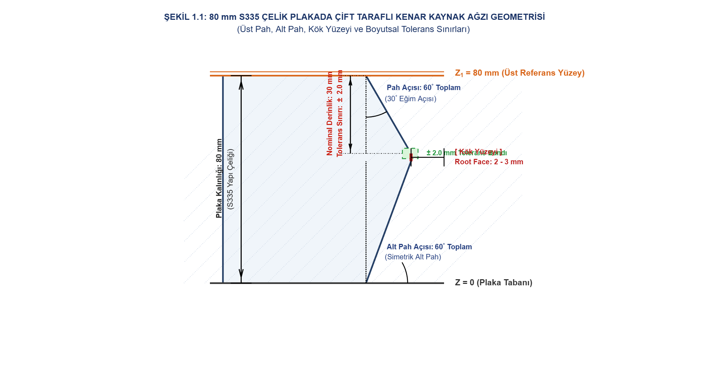
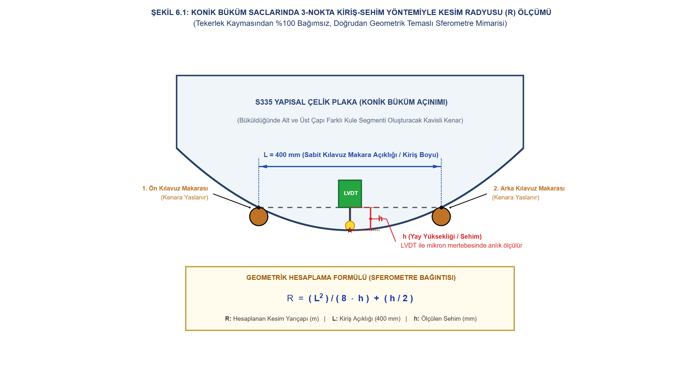

# Çift Problu V-Kaynak Ağzı ve Plaka Kesim Radyusu Kalite Kontrol Robotu

[](https://www.mathworks.com/products/matlab.html)
[](https://www.mathworks.com/products/simulink.html)
[](#2-monte-carlo-stokastik-doğrulaması-5000-koşu)
[](#2-monte-carlo-stokastik-doğrulaması-5000-koşu)
[](https://makina.itu.edu.tr)

> [!NOTE]
> **Akademik Bildirim:** Bu proje, **İstanbul Teknik Üniversitesi (İTÜ) Makina Mühendisliği Lisans Programı** bünyesinde yürütülen **Mekatronik Sistem Tasarımı** dersi kapsamında **Aydıner Dikme (030220086)** tarafından geliştirilmiştir.

Bu proje deposu, kalın yapısal çelik plakalarda ($80\text{ mm}$ S335) $13\text{ metre}$ boyundaki plaka kenarında hem **kaynak ağzı pah derinliğini** hem de silindirik/konik kule bükümü öncesi **düz kesim kavis yarıçapını (radyusunu)** eş zamanlı denetleyen otonom manyetik tekerlekli kalite kontrol robotunun **Simulink dinamik modelini** ve **5000 koşuluk Monte Carlo güvenilirlik analizini** barındırmaktadır.

---

## 📌 Çift Kanallı Denetim Mimarisi ve Çalışma İlkesi

Robot, $13\text{ metrelik}$ plaka boyunca sabit $v = 20\text{ mm/s}$ hızla ilerler ($650\text{ saniye}$). Şasi üzerinde iki bağımsız LVDT deplasman probu ve bir yüksek çözünürlüklü temaslı tekerlek enkoderi yer alır:

```text
                                      [ MEKATRONİK SİSTEM ŞEMASI ]

  [ Plaka Üst Yüzeyi Z1 = 80 mm ] 
            |
            v
  +-------------------------------------------------------------------------------------------------+
  | KANAL 1: Düşey LVDT Probu (Solartron AX/5/S)                                                   |
  | -> Pah Kök Derinliği: e(t) = Z1 - u(t)  | Nominal: 30.0 mm | Tolerans: +-2.0 mm (ISO 5817-B)   |
  +-------------------------------------------------------------------------------------------------+
            |
            |   [ 13 m Plaka Kenarı Boyunca Tarama (v = 20 mm/s, T = 650 s) ]
            v
  +-------------------------------------------------------------------------------------------------+
  | KANAL 2: Yatay LVDT Probu (3-Nokta Kiriş-Sehim / Sferometre Yöntemi)                             |
  | -> Sabit Makaralar Arası Kiriş L = 400 mm | Ölçülen Sehim h(t)                                  |
  | -> Hesaplanan Kavis Yarıçapı: R(t) = L^2 / (8 * h) = 20 / h [m]                                 |
  | -> Nominal Yarıçap: R_nom = 50.0 m (h_nom = 0.400 mm) | Tolerans: +-1.5 m (+-%3)               |
  +-------------------------------------------------------------------------------------------------+
            |
            v
  +-------------------------------------------------------------------------------------------------+
  | Sinyal Filtreleme & Karar Mekanizması:                                                          |
  | -> 1. Derece Alçak Geçiren Filtreler: G_dep(s) = 1/(0.1s+1), G_rad(s) = 1/(0.15s+1)             |
  | -> Enkoder (SICK DBV50E): 0.2 mm/darbe çözünürlük ile kusur boyuna konum tespiti                |
  | -> Çift Kanallı Tolerans Kıyaslayıcı: (|Delta e| > 2 mm) VEYA (|Delta R| > 1.5 m) -> ALARM / LOG|
  +-------------------------------------------------------------------------------------------------+
```

### 1. Kanal 1: Kaynak Ağzı Pah Derinliği $e(x)$
* **Geometri:** Üst referans $Z_1 = 80\text{ mm}$, taban montajı $50\text{ mm}$, nominal derinlik $30\text{ mm}$.
* **Tolerans:** ISO 5817 Seviye B standardı gereği $\pm 2.0\text{ mm}$ ($28.0\text{ mm} \le e \le 32.0\text{ mm}$).
* **Kusur Durumu:** Kök paso dalma derinliği kaçıklıkları (örn. $+3.5\text{ mm}$ aşırı dalma).

<p align="center">
  
</p>

### 2. Kanal 2: Konik Plaka Kesim Eğrilik Yarıçapı $R(x)$ (3-Nokta Kiriş-Sehim Yöntemi)
Rüzgar kulesi ve konik basınçlı kap imalatında plakalar bükülmeden önce açınım geometrisi gereği kavisli (radyuslu) kesilir. Robotun yan tarafında kök burnuna dayanan iki kılavuz rulman arası mesafe $L = 400.0\text{ mm}$'dir. Tam ortada bulunan yay baskılı yatay LVDT prob ucu kök burnu sehimini ($h$) ölçer:

$$R(t) = \frac{L^2}{8 \cdot h(t)} + \frac{h(t)}{2} \approx \frac{L^2}{8 \cdot h(t)}$$

* Nominal konik açınım yarıçapı $R_{\text{nom}} = 50.0\text{ m} = 50\,000\text{ mm}$ için:
  $$h_{\text{nom}} = \frac{400^2}{8 \times 50000} = \frac{160000}{400000} = 0.400\text{ mm} = 400\ \mu\text{m}$$
* Formül basitleştirmesi: $R\text{ [m]} = \frac{20}{h\text{ [mm]}}$.
* Tolerans Bandı: $50.0\text{ m} \pm 1.5\text{ m}$ ($\pm \%3$ kesim toleransı). Sehim karşılığı $h \in [0.388\text{ mm}, 0.412\text{ mm}]$ ($\Delta h \approx \pm 12\ \mu\text{m}$).
* Tekerlek kaymasından tamamen bağımsız, yerel geometrik 3-nokta temas ölçümüdür.

<p align="center">
  
</p>

---

## 🛠️ Donanım ve Sensör Özellikleri

| Bileşen | Marka / Model | Teknik Özellikler |
|---|---|---|
| **Düşey Deplasman Probu (K1)** | Solartron Metrology AX/5/S | $\pm 5\text{ mm}$ aralık, $0.5\%$ doğrusallık, $0.07\ \mu\text{m}$ tekrarlanabilirlik |
| **Yatay Deplasman Probu (K2)** | Solartron Metrology AX/5/S | 3-nokta kiriş-sehim temaslı yatay prob, nominal sehim $0.400\text{ mm}$ |
| **Sinyal Şartlandırıcı (2 Kanal)**| Solartron OD5 MK II | $500\text{ Hz}$ bant genişliği, $<1\text{ mV rms}$ gürültü ($\approx 3.2\ \mu\text{m}$) |
| **Konum Enkoderi** | SICK DBV50E-22ELA1000 | $0.2\text{ mm/darbe}$ ($1000\text{ P/R}$), $\pm 4\text{ mm/m}$ ölçek toleransı |
| **Yürüyüş Sistemi** | Otonom Manyetik Palet | $20\text{ mm/s}$ sabit hız, $13\text{ m}$ tek paso kesintisiz tarama |

---

## 📊 Simülasyon Çıktıları ve Doğrulama Metrikleri

### 1. Simulink Çift Kanallı Dinamik Simülasyon (`V_Kaynak_QC_Robot.slx`)
650 saniyelik 13 m plaka taraması boyunca her iki kanalda yapay kusurlar eş zamanlı koşturulmuştur:
* **Kanal 1 (Derinlik) Kusur 1 (100–120 s):** Ölçülen sapma $+3.508\text{ mm}$ (Hedef: $+3.5\text{ mm}$) $\rightarrow$ **TESPİT EDİLDİ [ALARM]**
* **Kanal 1 (Derinlik) Kusur 2 (350–380 s):** Ölçülen sapma $+3.499\text{ mm}$ (Hedef: $+3.5\text{ mm}$) $\rightarrow$ **TESPİT EDİLDİ [ALARM]**
* **Kanal 2 (Radyus) Kusur R1 (200–240 s):** Ölçülen yarıçap $38.13\text{ m}$ (Hedef: $38.0\text{ m}$) $\rightarrow$ **TESPİT EDİLDİ [ALARM - AŞIRI KAVİS]**
* **Kanal 2 (Radyus) Kusur R2 (480–520 s):** Ölçülen yarıçap $65.79\text{ m}$ (Hedef: $65.0\text{ m}$) $\rightarrow$ **TESPİT EDİLDİ [ALARM - DÜZLEŞME]**
* **Normal Bölgeler:** Filtrelenmiş derinlik sapması $\pm 0.069\text{ mm}$, hesaplanan yarıçap $49.94\text{ m}$ (tolerans sınırları içinde güvenli denetim).

### 2. Monte Carlo Stokastik Doğrulaması (5000 Koşu)
5000 farklı plaka taramasıyla ($13\,000\text{ km}$ eşdeğeri sanal fabrika denetimi) sistemin istatistiksel güvenilirliği test edilmiştir:

* **Kanal 1 (Derinlik) Tolerans Dışı Kusur Tespiti ($>2.0\text{ mm}$):** **%100.00** ($8286 / 8286$ kusur eksiksiz yakalandı)
* **Kanal 2 (Radyus) Tolerans Dışı Kusur Tespiti ($|\Delta R|>1.5\text{ m}$):** **%100.00** ($6991 / 6991$ kavis kusuru eksiksiz yakalandı)
* **Temiz Bölgede Asılsız Alarm Oranı:**
  * Kanal 1: **0.000 / tarama** (sıfır yanlış ret)
  * Kanal 2: **0.004 / tarama** (ihmal edilebilir)
* **Ölçüm Hataları:**
  * Düşey LVDT derinlik hatası: Ortalama **$-5.02\ \mu\text{m}$** (std: $28.5\ \mu\text{m}$)
  * Yatay LVDT kavis kestirim hatası: Ortalama **$0.04\text{ m}$** ($50\text{ metre}$ yarıçapta yalnızca $\%0.08$ hata!)
* **Kusur Konumlandırma Hatası (Enkoder):** Ortalama **$0.9 - 2.5\text{ mm}$** ($13\text{ m}$ boyunca).

<p align="center">
  
</p>

### 3. Atölye Zemin Titreşim Duyarlılığı
<p align="center">
  
</p>

---

## 📁 Proje Klasör Yapısı

```text
v-bevel-inspection-robot-radyus/
├── main.m                    # Ana simülasyon ve analiz betiği (Simulink + Monte Carlo)
├── V_Kaynak_QC_Robot.slx      # Çift kanallı Simulink blok diyagram modeli
├── vkaynak_qc_robot.m        # Çift kanallı Simulink modelini sıfırdan oluşturan script
├── README.md                 # Sistem mühendislik dokümantasyonu
├── docs/                     # Şemalar ve simülasyon grafikleri
│   └── assets/               # Şekiller ve grafik çıktıları
└── monte_carlo/              # Stokastik simülasyon kütüphanesi
    ├── mc_params.m           # Çift kanallı nominal sistem parametreleri
    ├── mc_simulate_run.m     # Tekil tarama simülatörü
    └── run_monte_carlo.m     # Bağımsız Monte Carlo koşturucusu
```

---

## 📚 Standartlar ve Akademik Kaynaklar

1. **ISO 9692-1:2013:** *Kaynak ve ilgili işlemler — Kaynak ağzı hazırlığı tipleri.*
2. **ISO 5817:2023:** *Çelik, nikel, titanyum ve alaşımlarında ergitme kaynaklı birleştirmeler — Kusurlar için kalite seviyeleri (Seviye B).*
3. **ISO 14253-1:2017:** *Geometrik ürün özellikleri (GPS) — Ölçümle muayene ve karar kuralları.*
4. **EN 1090-2 & EN 10025-2:** *Çelik yapı imalatı toleransları ve S335 yapısal çelik sac teknik teslim şartları.*
5. **Solartron Metrology:** *AX/5/S ve OD5 MK II LVDT Teknik Kataloğu ve Kullanım Kılavuzu.*
6. **SICK AG:** *DBV50 Core Ölçüm Tekerlekli Enkoder Teknik Kataloğu.*
